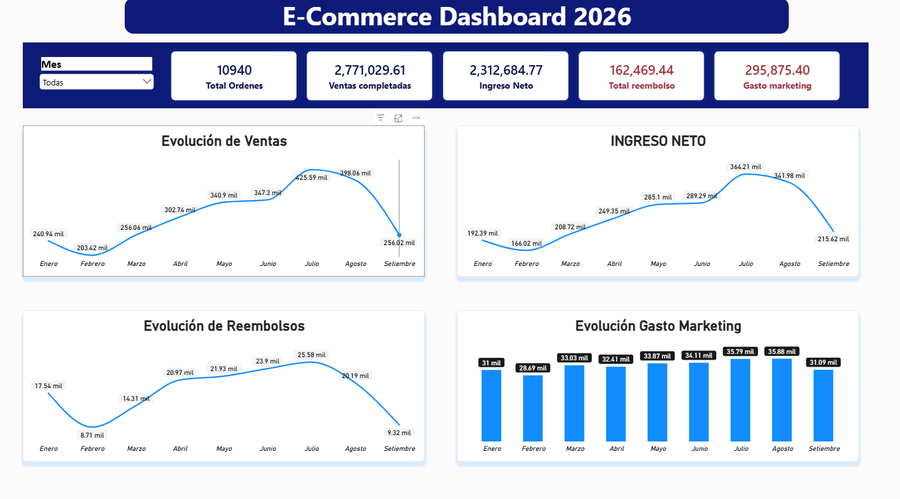
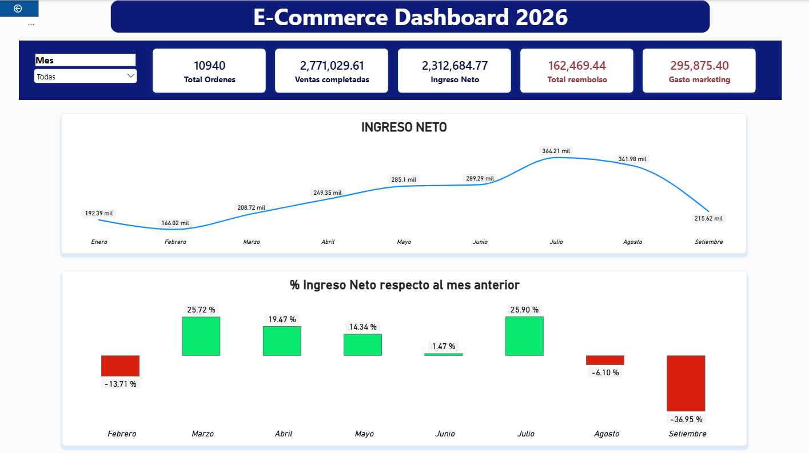
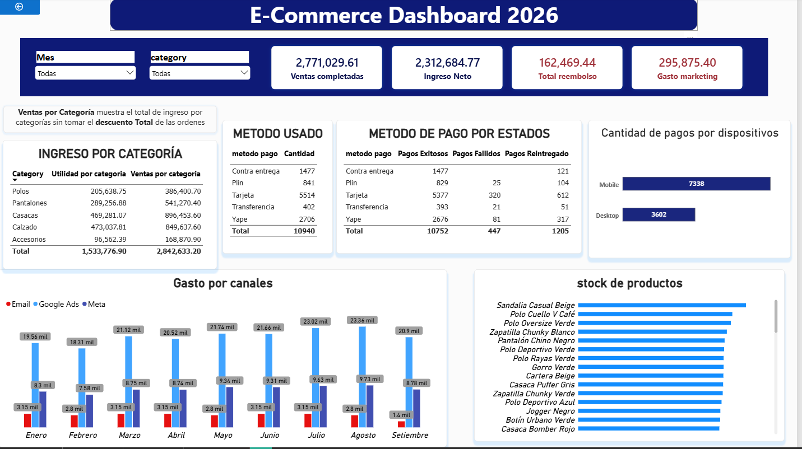

# 🛒 Análisis de caída de ingresos en un E-commerce de moda (SQL Server + Power BI)

Proyecto de análisis de datos de punta a punta: a partir de una base transaccional en **SQL Server** se investiga por qué los **ingresos netos de septiembre 2026 cayeron cerca de 37 % respecto a agosto**, y se presentan los resultados en un **dashboard de Power BI**.

---

## 📌 Contexto del negocio

*ModaPerú* es una tienda 100 % online que vende polos, pantalones, calzado, accesorios y casacas. El equipo de gerencia plantea la situación como un encargo de análisis:

> Los ingresos netos de septiembre cayeron respecto a agosto. ¿Qué pasó, cuánto pesa cada causa y qué hacemos al respecto?

Pistas iniciales del negocio: agosto tuvo una promoción en la primera quincena, marketing ajustó su presupuesto en septiembre, operaciones mencionó "algunos problemas" a fin de mes y atención al cliente reportó más quejas.

## 🎯 Objetivos

1. Confirmar la caída con una definición clara de ingreso neto.
2. Ubicar dónde se concentra: canal, categoría, método de pago, dispositivo.
3. Cuantificar en soles el efecto de cada causa identificada.
4. Proponer recomendaciones priorizadas.

## 🧰 Herramientas

| Herramienta | Uso |
|---|---|
| SQL Server (T-SQL) | Modelo de datos, validaciones y consultas de análisis |
| Power BI | Dashboard de 3 páginas (DAX para las métricas) |
| Excel | Ejercicio inicial de análisis por canal |

---

## 🗃️ Conjunto de datos

Periodo: **1 de enero al 30 de septiembre de 2026**.

| Tabla | Descripción | Filas |
|---|---|---|
| `customers` | Clientes, región y canal de adquisición | 6,796 |
| `products` | Catálogo (60 productos, 5 categorías) con costo y precio | 60 |
| `orders` | Cabecera de órdenes: canal, dispositivo, método de pago, cupón, estado | 10,940 |
| `order_items` | Detalle de productos por orden | 18,339 |
| `payments` | Libro de transacciones: intentos de pago, comisiones y reembolsos (en negativo) | 12,404 |
| `returns` | Devoluciones a nivel de ítem, con motivo y monto reembolsado | 993 |
| `daily_traffic` | Embudo diario por canal: sesiones, carritos, checkout | 1,365 |
| `marketing_spend` | Inversión diaria por canal, impresiones y clics | 619 |
| `inventory_snapshots` | Foto semanal (lunes) del stock por producto | 2,340 |
---

**Notas y mejoras pendientes**

- El "ingreso neto" actual descuenta el gasto de marketing, que es un gasto operativo. La definición más estricta sería *ventas completadas − reembolsos*, dejando el resultado después de marketing como una métrica aparte.
- Las devoluciones ocurren entre 6 y 25 días después de la compra. Los reembolsos de las últimas semanas de septiembre están **incompletos**, por lo que septiembre se ve ligeramente mejor de lo que será.
- Un `JOIN` entre `orders` y `order_items` duplica `total_amount` en órdenes con varios ítems. Los ingresos por categoría deben calcularse desde `order_items`.

---

## 📊 Dashboard (Power BI)

El dashboard tiene tres páginas:

1. **Dato general:** KPIs (órdenes, ventas completadas, ingreso neto, reembolsos, gasto de marketing) y evolución mensual.
2. **Ingreso neto:** evolución y variación porcentual contra el mes anterior.
3. **Concentración:** detalle de septiembre por categoría, método de pago, estado del pago, dispositivo, gasto por canal y stock de productos.
---
**Dato general:**

**Ingreso neto:**

**Concentración:**

---

## 🔎 Hallazgos

### Confirmados

- **Septiembre registra una caída de −36.95 %** en el ingreso neto frente a agosto (de S/ 341.98 mil a S/ 215.62 mil), la mayor variación negativa del año.
- **Cuatro productos de calzado quedaron sin stock** (Zapatilla Casual Beige, Classic Gris, Running Negra y Urbana Blanca), según las fotos semanales de inventario.
- El gasto de marketing bajó de S/ 35.88 mil a S/ 31.09 mil, y el canal Email muestra una inversión muy baja en septiembre.

### En investigación

- Magnitud en soles del quiebre de stock respecto a la caída total de ventas completadas.
- Patrón de **pagos fallidos con tarjeta** en septiembre, cruzado por dispositivo y fecha de inicio.
- Descomposición de la caída en **número de órdenes** vs. **ticket promedio**.
- Efecto del fin de la promoción de agosto y del cambio de mezcla de categorías.
  
---

## 💡 Recomendaciones *(por completar tras cuantificar)*

1. _Reabastecer los productos de mayor rotación y alertar antes de llegar a stock cero._
2. _Revisar la integración con la pasarela de pagos en tarjeta, especialmente en móvil._
3. _Reevaluar el recorte de inversión en canales con mejor retorno._

---

## 🧠 Habilidades demostradas

- Modelado relacional y validación de integridad entre tablas.
- T-SQL: agregaciones, `JOIN`, `CASE`, segmentación y descomposición de métricas.
- Pensamiento analítico: formular hipótesis, segmentar antes de concluir y cuantificar el impacto.
- Visualización y storytelling de datos con Power BI.
- Documentación de supuestos y limitaciones de los datos.

---

## 👤 Pável J. Huamaní

